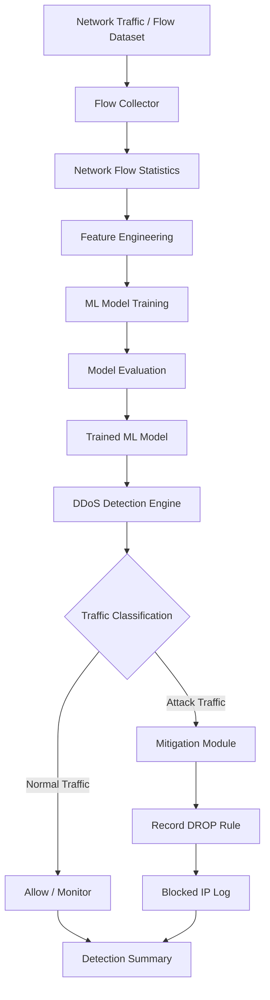

# 🛡️ SDN-Based DDoS Attack Detection and Mitigation Using Machine Learning

<p align="center">
  <strong>An Intelligent Network Security Framework for Flow-Based DDoS Detection and Automated Mitigation</strong>
</p>

<p align="center">
  
  
  
  
  
</p>

---

## 📌 Overview

Distributed Denial-of-Service (DDoS) attacks are among the major threats to network availability. They attempt to overwhelm target systems with excessive traffic, resulting in service disruption and degraded network performance.

This project implements a **Machine Learning-based DDoS Attack Detection and Mitigation System inspired by Software-Defined Networking (SDN)**.

The system analyzes network-flow statistics, extracts meaningful traffic features, trains and evaluates multiple machine learning classifiers, and identifies suspicious traffic patterns. Based on the predicted attack classification, a mitigation module demonstrates how malicious source IP addresses can be recorded for traffic blocking.

The primary objective is to explore how machine learning can improve network traffic analysis and support automated security response mechanisms in SDN environments.

> **Implementation scope:** The current implementation uses simulated network-flow generation and in-memory mitigation records. Live Ryu controller polling and actual OpenFlow rule installation are planned enhancements.

## 🎯 Problem Statement

Traditional network security mechanisms often depend on predefined rules and signatures to identify malicious traffic. These approaches can face challenges when dealing with changing traffic patterns and previously unseen attack behavior.

A DDoS detection system should be capable of:

- Analyzing network traffic continuously.
- Identifying abnormal traffic characteristics.
- Distinguishing legitimate traffic from suspicious flows.
- Minimizing false-positive detections.
- Supporting timely mitigation of malicious traffic.

## 💡 Proposed Solution

The proposed solution combines **Software-Defined Networking concepts and supervised Machine Learning** to demonstrate an intelligent traffic detection pipeline.

The system follows four major stages:

1. **Flow Collection:** Generates and processes network-flow records from simulated switches.
2. **Feature Engineering:** Extracts network traffic characteristics and derives additional detection features.
3. **Attack Detection:** Uses trained ML classifiers to classify traffic as normal or malicious.
4. **Attack Mitigation:** Records simulated DROP rules against source IP addresses classified as malicious.

## ✨ Key Features

- 📡 Flow-based network traffic analysis.
- 🤖 Machine Learning-based attack classification.
- 🧠 Comparison of four supervised ML algorithms.
- 📊 Eight traffic-related detection features.
- ⚡ Feature engineering for flow intensity and burst density.
- 🎯 Attack probability estimation.
- 🛡️ Simulated automated IP-based mitigation.
- 📈 Model evaluation using multiple classification metrics.
- 🔍 Confusion matrix and feature importance analysis.
- 🧩 Modular Python implementation.

## 🏗️ System Architecture

The architecture represents the complete workflow from network-flow collection to attack detection and mitigation.



## 🔄 Working Methodology

### 1. Network Flow Collection

The flow collector generates network-flow records across four simulated switches.

Each flow contains information such as:

- Source IP address
- Destination IP address
- Packet count
- Byte count
- Flow duration
- Packet rate
- Byte rate
- Average bytes per packet

The implementation demonstrates normal and attack-like traffic generation.

### 2. Feature Engineering

Two additional features are calculated to provide more information about traffic behavior.

**Flow Intensity**

```python
flow_intensity = pkt_count * pkt_rate
```

**Burst Density**

```python
burst_density = pkt_count / (duration_sec ** 2)
```

These features represent traffic volume and short-duration burst behavior.

### 3. Machine Learning Model Training

Four supervised machine learning algorithms are trained and evaluated:

| Algorithm | Purpose |
|---|---|
| Random Forest | Ensemble-based classification |
| Support Vector Machine (SVM) | Classification using an RBF kernel |
| K-Nearest Neighbors (KNN) | Distance-based classification |
| Gradient Boosting | Sequential ensemble learning |

The dataset is divided into:

- 70% Training Data
- 30% Testing Data

Stratified splitting is used to preserve class proportions.

The selected classifier is saved as `rf_model.pkl`.

### 4. Attack Detection

The detection module loads the trained model and analyzes network-flow records.

Each flow receives a prediction:

- `0` → Normal Traffic
- `1` → Attack Traffic

The model also provides an estimated attack-class probability.

### 5. Attack Mitigation

When suspicious flows are identified, the mitigation module:

- Extracts the source IP address.
- Identifies the associated simulated switch.
- Records traffic-related information.
- Adds a simulated `DROP` action.
- Maintains a mitigation log.

The current implementation records mitigation actions in program memory rather than installing actual firewall or OpenFlow rules.

## 🧰 Technical Stack

| Technology | Application |
|---|---|
| Python | Core programming language |
| Pandas | Dataset processing and manipulation |
| NumPy | Numerical computations |
| Scikit-learn | Machine Learning implementation |
| Random Forest | Ensemble classification |
| SVM | Support Vector Classification |
| KNN | Distance-based classification |
| Gradient Boosting | Ensemble learning |
| Pickle | Model serialization |
| CSV | Network traffic dataset |
| SDN | Network architecture concepts |
| OpenFlow | SDN communication and flow-rule concepts |

## 📊 Dataset and Feature Description

The project uses `FlowStatsfile_NEW.csv` as its network-flow dataset.

The training script describes a dataset containing 2,000 records. Verify the actual CSV before publishing dataset statistics.

### Detection Features

| Feature | Description |
|---|---|
| `pkt_count` | Total number of packets |
| `byte_count` | Total bytes transferred |
| `duration_sec` | Flow duration |
| `pkt_rate` | Packets transmitted per second |
| `byte_rate` | Bytes transmitted per second |
| `byte_per_pkt` | Average bytes per packet |
| `flow_intensity` | Packet count × packet rate |
| `burst_density` | Packet count / duration squared |

### Target Labels

| Label | Classification |
|---|---|
| 0 | Normal Traffic |
| 1 | DDoS / Attack Traffic |

## 📁 Project Structure

```text
SDN-DDoS-Detection/
│
├── controller.py
│
├── train_model.py
│
├── detection.py
│
├── mitigation.py
│
├── run_project.py
│
├── FlowStatsfile_NEW.csv
│
├── requirements.txt
│
├── .gitignore
│
└── README.md
```

| File | Description |
|---|---|
| `controller.py` | Simulates network-flow collection |
| `train_model.py` | Trains and evaluates ML classifiers |
| `detection.py` | Performs attack classification |
| `mitigation.py` | Demonstrates IP-based mitigation |
| `run_project.py` | Combined project execution script |
| `FlowStatsfile_NEW.csv` | Input network-flow dataset |

## ⚙️ Installation and Setup

### Prerequisites

- Python 3.10+
- Git
- pip
- VS Code or any Python IDE

### Step 1: Clone the Repository

```bash
git clone https://github.com/YOUR_USERNAME/SDN-DDoS-Detection.git
```

```bash
cd SDN-DDoS-Detection
```

### Step 2: Create a Virtual Environment

**macOS / Linux**

```bash
python3 -m venv venv
source venv/bin/activate
```

**Windows**

```bash
python -m venv venv
venv\Scripts\activate
